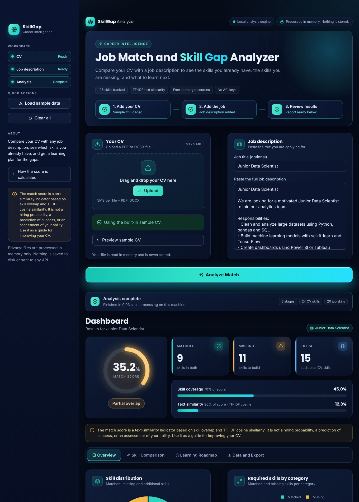

# Job Match and Skill Gap Analyzer

A Streamlit web app that compares a CV with any job description, shows which technical skills match or are
missing, and recommends free resources to close the gaps. It runs fully locally: no paid APIs, no API keys,
and uploaded CVs are never stored.



> The match score is a **text-similarity indicator**. It is not a hiring probability or a prediction of success.

## Features
- Upload a CV as PDF or DOCX and paste any job description
- Skill extraction from both documents using a curated dictionary with aliases (for example `sklearn` maps to scikit-learn)
- Match score combining skill coverage (70%) and TF-IDF cosine similarity (30%)
- Matched, missing and additional CV skills
- Premium dark dashboard (navy, teal and cyan) with glass-style cards, responsive from phone to desktop
- Live processing panel that shows each real analysis stage (reading, normalizing, skill detection, TF-IDF, scoring) with its actual result
- Dashboard: circular score indicator, skill distribution donut, category bars, category radar, most emphasised skills in the job description
- Personalized recommendations generated from your own result (biggest gaps, quick wins, strengths, skills that need more evidence)
- Phased learning roadmap with free resources and the skill coverage reached after each phase
- Filterable data table with CSV and TXT export
- Built-in sample data, error handling for empty, oversized, corrupted, password-protected and scanned files
- Accessible: AA text contrast, keyboard focus styles, reduced-motion support

## Tech stack
| Technology | Used for |
|---|---|
| Python | Application code |
| Streamlit | Web interface |
| PyMuPDF, python-docx | PDF and DOCX text extraction |
| NLTK | Tokenization and Porter stemming |
| Scikit-learn | TF-IDF vectorizer (1-2 grams) and cosine similarity |
| Pandas | Skill-gap table, category aggregation, CSV export |
| Plotly | Interactive charts |

## Project structure
| File | Purpose |
|---|---|
| `app.py` | Streamlit interface and dashboard |
| `extractor.py` | CV text extraction and error handling |
| `preprocess.py` | Text cleaning, NLP preprocessing, skill extraction |
| `matcher.py` | TF-IDF similarity, skill comparison, recommendations (optional `progress` callback reports real stages to the UI) |
| `skills_db.py` | Skill dictionary, aliases, learning resources, sample data |
| `.streamlit/config.toml` | Dark theme and upload limit |

## How the score works
1. Both texts are cleaned (lowercased, URLs and emails removed).
2. Known skills are found in each text. Coverage = matched skills / skills required by the job.
3. Text is tokenized, stop-words removed and stemmed, then compared with TF-IDF and cosine similarity.
4. Score = 70% coverage + 30% text similarity.

## Installation
```bash
git clone https://github.com/<your-username>/job-match-skill-gap-analyzer.git
cd job-match-skill-gap-analyzer
python -m venv venv
source venv/bin/activate        # Windows: venv\Scripts\activate
pip install -r requirements.txt
```

## Run
```bash
streamlit run app.py
```
Open http://localhost:8501 and click **Load sample data** in the sidebar.

## Deploy (free)
1. Push the repository to GitHub.
2. Go to https://share.streamlit.io and sign in with GitHub.
3. Choose **New app**, select the repository, set the main file to `app.py`, and deploy.

## Privacy
Files are read in memory and never written to disk. No data is sent to any external service.

## Limitations
- Skill detection is dictionary-based; skills outside `skills_db.py` are not detected.
- Scanned image-only PDFs are not supported (no OCR).
- The score does not measure experience level, seniority or soft qualities.

## Extend
Add skills, aliases and learning links in `skills_db.py`.

## License
MIT. See `LICENSE`.
